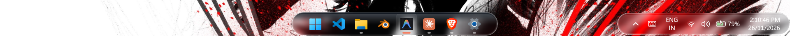
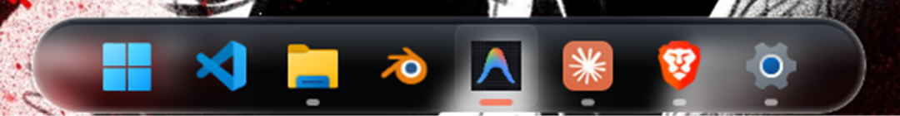
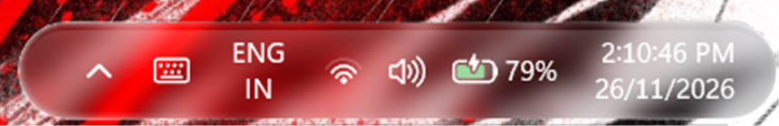
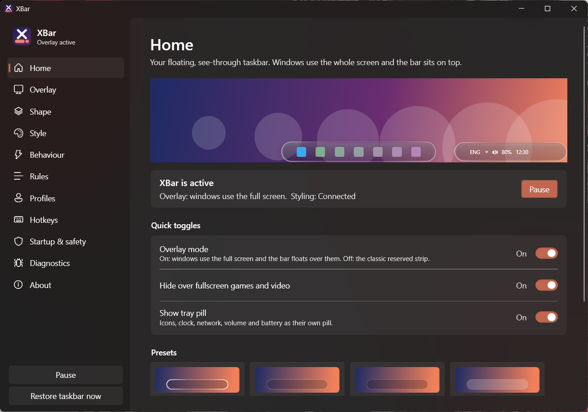
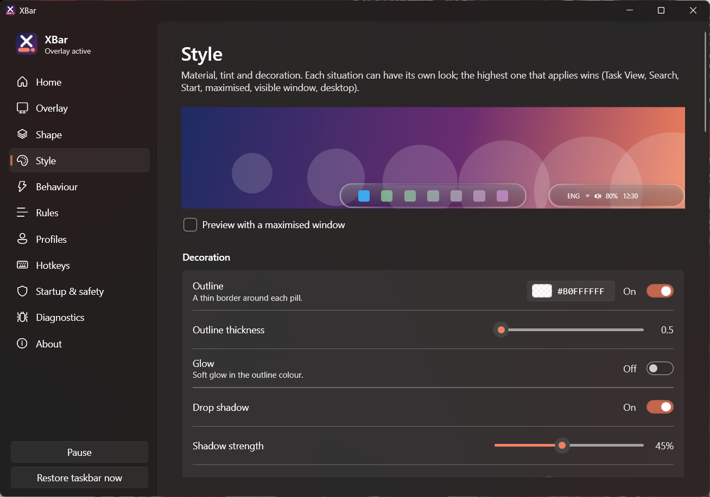
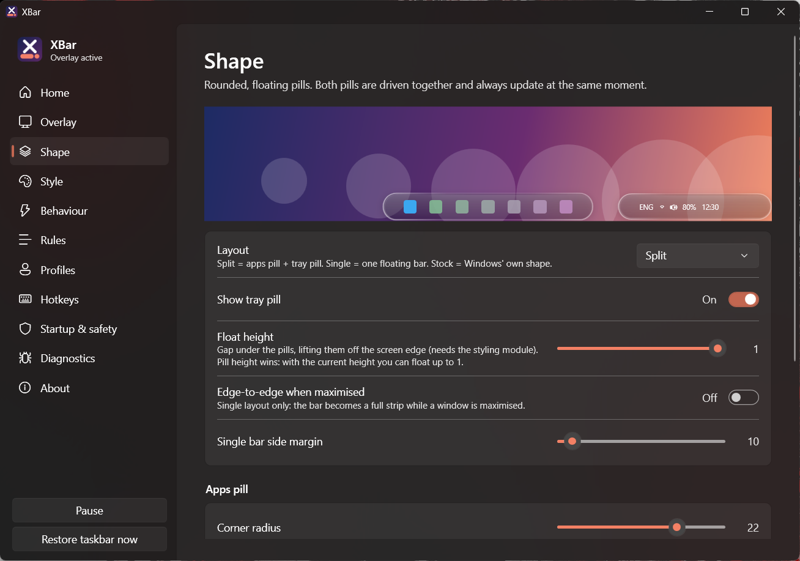
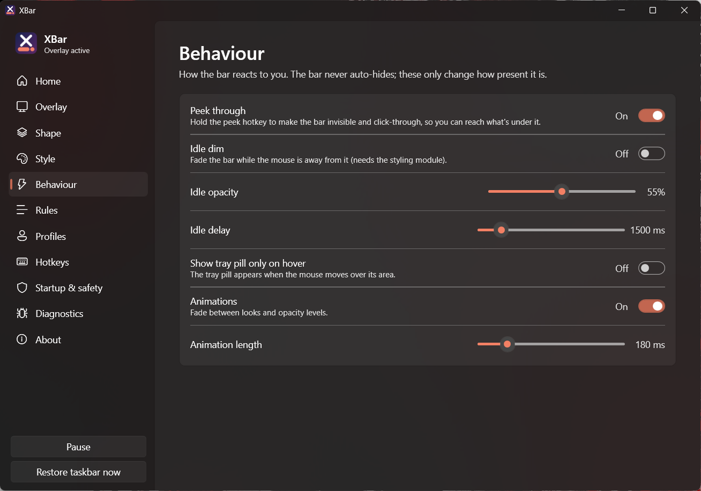

<p align="center">
  
</p>

<h1 align="center">XBar</h1>

<p align="center">
  A floating, rounded, see-through <b>overlay taskbar</b> for Windows 11.<br>
  Your windows use the whole screen. The taskbar hovers on top.
</p>

<p align="center">
  <a href="https://github.com/drachmacollector/XBar/releases/latest"><b>Download</b></a> ·
  <a href="#features">Features</a> ·
  <a href="#hotkeys">Hotkeys</a> ·
  <a href="#if-something-goes-wrong">Troubleshooting</a> ·
  <a href="#building-from-source">Build</a>
</p>

<p align="center">
  
</p>

## What it does

Windows normally reserves a solid strip at the bottom of the screen for the taskbar, so maximised windows stop
above it. XBar gives that strip back. Maximised and snapped windows run edge to edge, and the taskbar becomes
two floating pills (apps and tray) with a liquid-glass look. Clicks anywhere outside the pills go straight
through to the window underneath.

<p align="center">
  
  
</p>

XBar works with the real Windows taskbar, so pinning, jump lists, notifications and the Start menu all keep
working. It does not replace Explorer or ask for administrator rights.

## Install

1. Download **`XBar-Setup-<version>.exe`** from the [latest release](https://github.com/drachmacollector/XBar/releases/latest).
2. Run it. It installs for your user account only, needs no admin rights, and bundles everything it needs (no separate .NET install).
3. Open XBar from the Start menu or the tray icon, and use the control panel to shape the bar.

**Requirements:** Windows 11 (64-bit). Taskbar **auto-hide must be off** (Settings › Personalization › Taskbar › Taskbar behaviors).
Close TranslucentTB and RoundedTB first; they fight over the same taskbar.

> Windows SmartScreen may warn that the installer is from an unknown publisher, because it is not code-signed.
> Choose **More info › Run anyway**. The full source is in this repository.

Prefer no installer? Build the portable folder yourself, see [Building from source](#building-from-source).

## Features

- **True overlay.** Maximised and snapped windows use the full screen; the bar floats over them.
- **Shape.** Split pills (apps + tray) or one floating bar. Corner radius, margins, padding, height and float gap.
- **Style.** Liquid glass (default), normal, opaque, clear, blur or acrylic. Tint colour with alpha, outline, glow,
  shadow, gradient, accent-colour sync, and a separate light-theme look.
- **Dynamic looks.** A different style for the desktop, an open window, a maximised window, Start, Search and Task View.
- **Behaviour.** Hides over fullscreen games and video, peek-through hotkey, idle dim, tray-on-hover,
  per-app rules (reserve space / always show / hide / custom look) and profiles.
- **Any edge.** Works with the taskbar docked at the bottom, top, left or right.
- **Safe by design.** Every change is temporary and undone on exit, by a watchdog if XBar crashes,
  and at the next launch if needed.

### The control panel

Left-click the tray icon to open it; right-click for the quick menu. Everything applies live.

<table>
  <tr>
    <td></td>
    <td></td>
  </tr>
  <tr>
    <td></td>
    <td></td>
  </tr>
</table>

## Hotkeys

| Default hotkey | Action |
|---|---|
| <kbd>Ctrl</kbd>+<kbd>Win</kbd>+<kbd>Alt</kbd>+<kbd>R</kbd> | **Panic:** restore the taskbar now and pause |
| <kbd>Ctrl</kbd>+<kbd>Win</kbd>+<kbd>Alt</kbd>+<kbd>P</kbd> | Pause / resume |
| <kbd>Ctrl</kbd>+<kbd>Win</kbd>+<kbd>Alt</kbd>+<kbd>O</kbd> | Overlay ↔ classic reserved strip |
| <kbd>Ctrl</kbd>+<kbd>Win</kbd>+<kbd>Alt</kbd>+<kbd>Space</kbd> (hold) | Peek through the bar |
| <kbd>Ctrl</kbd>+<kbd>Win</kbd>+<kbd>Alt</kbd>+<kbd>N</kbd> | Next profile |

All hotkeys can be changed on the **Hotkeys** page.

## If something goes wrong

Your taskbar is never left broken. In order of effort:

1. Press <kbd>Ctrl</kbd>+<kbd>Win</kbd>+<kbd>Alt</kbd>+<kbd>R</kbd>, or tray menu › *Restore taskbar now*.
2. Start menu › XBar › **XBar - Restore taskbar** (runs `XBar.exe --restore`).
3. Run `powershell -ExecutionPolicy Bypass -File restore.ps1` from the install folder (no XBar needed; add `-Explorer` to restart Explorer).
4. Last resort: sign out, or run `taskkill /f /im explorer.exe` and then `start explorer.exe`.

Start XBar holding <kbd>Shift</kbd> (or with `--safe`) to open it without applying anything.

| | |
|---|---|
| Settings | `%LOCALAPPDATA%\XBar\settings.json` (hand edits apply live) |
| Logs | `%LOCALAPPDATA%\XBar\logs` |

## Uninstall

Settings › Apps › Installed apps › **XBar** › Uninstall. The uninstaller restores the taskbar first and
asks whether to delete your settings.

## How it works

Explorer reserves the taskbar strip by setting the monitor *work area*. XBar sets the work area to the
full monitor **without** broadcasting `WM_SETTINGCHANGE` (Explorer recomputes and undoes it whenever it
sees that broadcast), then notifies other apps directly and re-fits already-maximised windows. The taskbar
window is clipped with `SetWindowRgn` to the pill shapes, so the rest of the strip is click-through.

Styling is done by `XBar.Tap.dll`, loaded into Explorer through XAML Diagnostics, which replaces the taskbar's
background with anti-aliased pills. See [PLAN.md](PLAN.md) for the full design.

| Part | What it is |
|---|---|
| `src/XBar.Core` | Engine: geometry, work-area handling, rules, profiles, settings, safety journal and watchdog |
| `src/XBar.App` | WPF control panel, tray icon, hotkeys, shortcuts |
| `src/XBar.Tap` | C++/WinRT module that runs inside Explorer and paints the pills |
| `installer/` | Inno Setup script for the installer |

## Building from source

Requires the .NET 10 SDK and Visual Studio 2022 Build Tools (Desktop C++ workload, Windows 11 SDK).

```powershell
.\build.ps1             # debug build
.\build.ps1 -Test       # + unit tests
.\build.ps1 -Release    # portable build in .\publish\XBar
.\tools\make-installer.ps1   # installer in .\artifacts\installer (needs Inno Setup 6 or 7)
```

Icons are generated by `python tools/make_icons.py` (Pillow).

## Licence

GPL-3.0-or-later. Credits: see [THIRD_PARTY_NOTICES.md](THIRD_PARTY_NOTICES.md).
